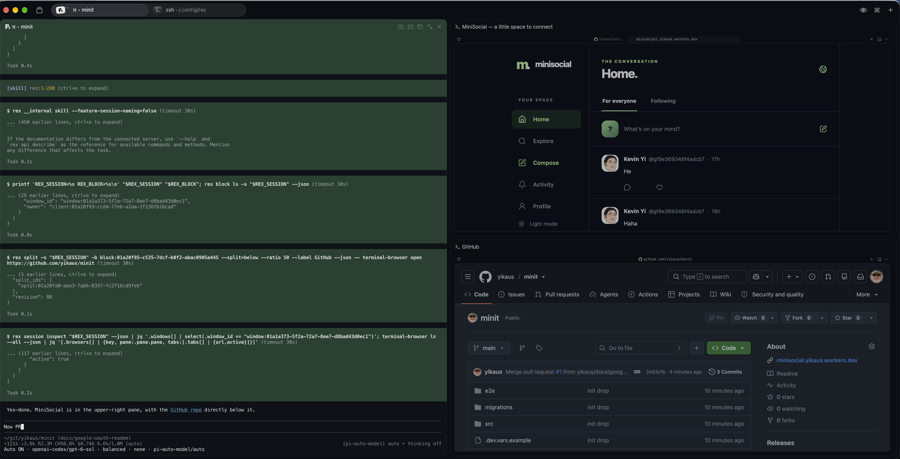

# MiniSocial

A mobile-first microblog, hosted as **one Cloudflare Worker**: React/Vite static assets + Hono API, Better Auth sessions in D1, R2 images, short-lived KV profile summaries, and idempotent Queue-driven notifications. No external services, Durable Objects, or Workflows.

## Built with pi in Rex

This project was created with [pi](https://github.com/badlogic/pi-mono) using a GPT-6 model in [Rex](https://www.superlogical.com/rex). The screenshot shows the pi coding session alongside MiniSocial and this GitHub repository in Rex panes.



## Local development

Requires Node 20+, pnpm 10+, a Cloudflare account for deployment.

```sh
pnpm install
cp .dev.vars.example .dev.vars
# Replace BETTER_AUTH_SECRET in .dev.vars with: openssl rand -base64 32
pnpm db:migrate:local
pnpm dev
```

Open http://localhost:5173. Local D1/R2/KV/Queues are emulated by the Cloudflare Vite plugin; no account is needed for local development. Set `AUTH_URL` to the **exact** browser origin (scheme + host + port), without a path or trailing slash. Development cookies are HttpOnly and SameSite=Lax; production cookies are also Secure.

## Tests

```sh
pnpm test                 # Vitest input-validation tests
pnpm exec playwright install chromium
pnpm test:e2e             # 320px/375px mobile social journey, authz, reply, follow, like
pnpm build                # typecheck + production Worker/assets bundle
```

## Cloudflare deployment

Create resources (the queue consumer uses a dead-letter queue):

```sh
pnpm exec wrangler login
pnpm exec wrangler d1 create minisocial
pnpm exec wrangler r2 bucket create minisocial-media
pnpm exec wrangler kv namespace create CACHE
pnpm exec wrangler queues create minisocial-events
pnpm exec wrangler queues create minisocial-events-dlq
```

Copy the returned D1 database UUID and KV namespace ID into `wrangler.jsonc`, replacing the `REPLACE_WITH_*` placeholders. Ensure that the rate-limit namespace IDs (`1001`–`1003`) are unique for this account; Worker rate-limit bindings are configured with a 60-second period. For production, set the exact public origin for auth and an independent, random secret:

```sh
pnpm exec wrangler secret put BETTER_AUTH_SECRET
pnpm exec wrangler secret put AUTH_URL
pnpm db:migrate:remote
pnpm deploy
```

For a custom domain, update `AUTH_URL` to the custom-domain origin and redeploy. Do not check in `.dev.vars` or expose secrets via Vite variables.

### Google sign-in

Google OAuth sign-in is supported alongside email/password authentication. Once configured, the sign-in screen offers **Continue with Google**; no Google credentials are needed to use email/password sign-in.

Create a Google OAuth client in Google Cloud Console. Add this authorized redirect URI exactly: `https://minisocial.yikaus.workers.dev/api/auth/callback/google` (replace the host if using a custom domain). Then configure the Worker secrets:

```sh
pnpm exec wrangler secret put GOOGLE_CLIENT_ID
pnpm exec wrangler secret put GOOGLE_CLIENT_SECRET
pnpm run deploy
```

Google sign-in is hidden until both secrets are configured. Set `GOOGLE_CLIENT_ID` and `GOOGLE_CLIENT_SECRET` in `.dev.vars` for local OAuth testing, and add `http://localhost:5173/api/auth/callback/google` as a Google redirect URI. The sign-in screen only shows Google when both credentials are configured. OAuth accounts receive a random `g…` username; email/password registration still requires the user to choose a valid username. Apply `pnpm db:migrate:local` before running local auth tests. The OAuth account's email must be suitable for this app's account policies; email verification behavior depends on Google's returned verified-email claim. Never put the client secret in frontend code. The Vite plugin generates the static asset binding automatically.

## Design notes

- D1 is the source of truth. Likes/follows are unique pairs and counts are derived with SQL. Feed cursors use `(created_at, id)` descending. Replies are posts with a `parent_id`. Search uses escaped SQL `LIKE` with a limit; this is intended for a small community, not millions of posts.
- Authentication is Better Auth email/password with its salted password hashing and database-backed sessions; Hono resolves the session on API requests. Unsafe methods require a matching `Origin`, including auth routes; Better Auth also enforces trusted origins. Passwords must be 10+ characters. Email verification and password reset are **not configured** because there is no outbound email provider. For a public launch, add verified email delivery and recovery, a moderation/reporting flow, and bot challenges at the edge.
- Uploaded JPEG/PNG/WebP images are capped at 5 MB, checked against signature bytes, stored under random R2 keys, and served through a D1-checked Worker route only when attached to a post or used as an avatar. This is basic validation, **not** a full image decoder or malware scan; a public launch should re-encode images in a trusted processing pipeline. Unattached objects older than a day are removed by cron. Uploaded images are public once referenced; there are no private profiles.
- KV holds **public** profile summaries for 60 seconds. Profile edits and follows delete the cached entry, but KV deletion may propagate asynchronously: another edge can show stale data until TTL expiry. Viewer-specific follow state is never cached. Avoid KV for authoritative counts or rate limiting.
- Cloudflare rate-limit bindings protect auth (per IP), posts/likes/actions (per user) and uploads (per user). They are best-effort edge abuse protection, not a globally strongly consistent quota; use Cloudflare WAF/bot protections for a publicly exposed installation.
- Queue notifications use a unique database constraint plus `INSERT OR IGNORE` to make retries idempotent. A failed queue send after a committed like/reply can omit a notification; the social action remains committed. Dead-letter messages can be inspected/replayed from the queue. Daily cron cleans up orphaned uploads. No Durable Object is necessary because notifications are fetched on page load, not realtime.
- Observability is enabled in `wrangler.jsonc`; view Worker logs and request traces in Cloudflare. D1 migrations live in `migrations/`. Back up D1/R2 before schema-changing production deployments.
